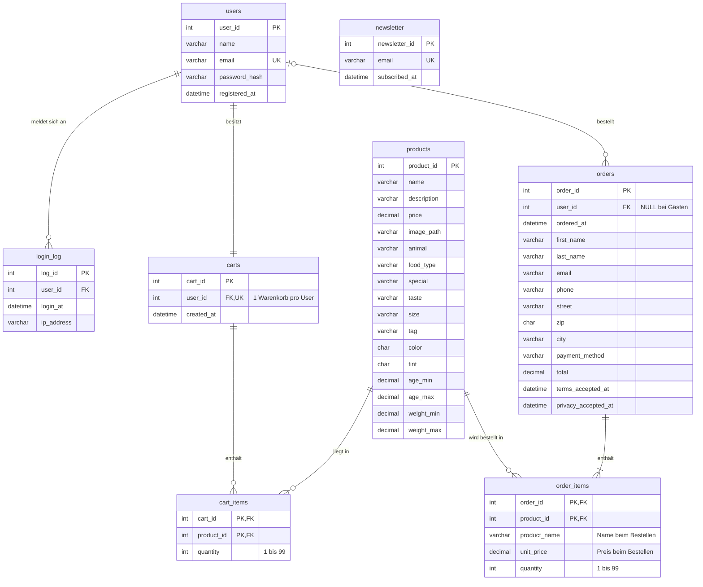

# Tierfutter-Shop (Schulprojekt)

Kleiner Online-Shop für Tierfutter mit Registrierung, Login, Warenkorb und
Bestellung. Der Shop ist eine einzige Seite (`index.html`), dazu kommen
AGB und Datenschutzerklärung. Bestellen geht mit Konto oder als Gast.

- **Frontend:** HTML, CSS, JavaScript (ohne Framework, ohne Build)
- **Backend:** PHP 8 mit PDO
- **Datenbank:** MySQL / MariaDB (XAMPP), Datenbank `tierfutter_shop`

---

## Ziel und Anforderungen

Ziel ist ein kleiner Webshop für Tierfutter. Die Startseite `index.html` ist
gleichzeitig der Shop: Man wählt dort direkt Produkte aus, legt sie in den
Warenkorb und bestellt. Auch nach dem Login bleibt man auf dieser Seite.

**Anforderungen**
- Registrierung mit Name, E-Mail und Passwort
- Login mit E-Mail und Passwort
- Passwörter nur als Hash speichern (`password_hash` / `password_verify`)
- Kardinalitäten im Datenmodell sauber abbilden (1 : 1, 1 : N, N : M)
- Technik: PHP mit PDO (Standard, nicht vorgegeben)
- Weitere Funktionen sind freiwillig, es gibt keine Vorgaben der Lehrperson

**Umgebung**
- Windows mit XAMPP Control Panel v3.3.0 (Apache, MariaDB 10.4, PHP 8.2)
- phpMyAdmin oder MySQL Workbench zum Verwalten der Datenbank
- Eigene Datenbank `tierfutter_shop`. Die vorhandenen Datenbanken
  `phpmyadmin` und `test` werden nicht verändert.

---

## Projektstand

| Bereich | Stand |
|---|---|
| Landingpage mit Produktfilter (`index.html`, `css/style.css`, `js/script.js`) | ✅ fertig |
| Produkte aus der Datenbank (`api/products.php`), Änderung in phpMyAdmin sofort sichtbar | ✅ fertig |
| Datenbankschema mit echten Produkten (`database/schema.sql`) | ✅ fertig, in MariaDB 10.4 (XAMPP) getestet |
| Registrierung (Name, E-Mail, Passwort) | ✅ fertig |
| Login / Logout mit Session und Login-Protokoll | ✅ fertig |
| Warenkorb in der Datenbank (eingeloggt) | ✅ fertig |
| Gast-Warenkorb im Browser, Übernahme beim Login | ✅ fertig |
| Anzeige des eingeloggten Users im Header | ✅ fertig |
| Bestellung mit Kontaktdaten, Lieferadresse und Zahlungsart (auch als Gast) | ✅ fertig |
| Pflicht-Zustimmung zu AGB und Datenschutz, Newsletter freiwillig | ✅ fertig |
| "Meine Bestellungen" für eingeloggte User | ✅ fertig |
| AGB- und Datenschutz-Seite (Mustertexte) | ✅ fertig |
| Echte Zahlung / Lieferung | ❌ nicht geplant (Schulprojekt) |
| Admin-Rolle, "Passwort vergessen" | ⏳ optional, falls am Schluss noch Zeit bleibt |

---

## Installation (XAMPP)

PHP läuft nur über den Apache-Server, nicht beim Doppelklick auf
`index.html` und nicht mit "Live Server".

1. **Projekt für Apache verfügbar machen.** Entweder den Projektordner nach
   `C:\xampp\htdocs\tierfutter-shop` kopieren bzw. dorthin klonen, oder ihn an
   seinem Ort lassen und in `htdocs` nur eine Verknüpfung (Junction) darauf
   anlegen. Dann gibt es keine zweite Kopie. Einmalig in der
   Eingabeaufforderung (cmd) ausführen, `<Projektordner>` durch den eigenen
   Pfad ersetzen:
   ```
   mklink /J C:\xampp\htdocs\tierfutter-shop "<Projektordner>"
   ```
   Wird der Projektordner verschoben oder umbenannt, die Verknüpfung in
   `htdocs` löschen und neu anlegen. Beim Löschen der Verknüpfung bleibt der
   Projektordner erhalten.
2. **Zugangsdaten anlegen:** Im Ordner `includes/` die Datei
   `config.local.example.php` kopieren und die Kopie in `config.local.php`
   umbenennen. Für XAMPP passen die Werte so
   (Benutzer `root`, kein Passwort). Sonst Benutzer und Passwort dort ändern.
   `config.local.php` wird nicht in Git gespeichert.
3. **XAMPP Control Panel:** Apache und MySQL starten.
4. **Datenbank importieren** mit phpMyAdmin:
   - `http://localhost/phpmyadmin` öffnen
   - Links oben auf das Haus-Symbol klicken (keine Datenbank auswählen)
   - Reiter *Importieren* → *Datei auswählen* → `database/schema.sql` → unten *Importieren*
   - Links erscheint `tierfutter_shop` mit 8 Tabellen, `products` enthält 7 Produkte
   - **Achtung:** Das Skript löscht die Tabellen in `tierfutter_shop` und
     legt sie neu an. Alle Benutzer, Warenkörbe und Bestellungen gehen dabei
     verloren. Die Datenbanken `phpmyadmin` und `test` werden nicht verändert.
   - **Bestehende Datenbank ohne Bestellungen?** Statt `schema.sql` nur
     `database/update_orders.sql` importieren. Das Skript legt nur die
     Tabellen `orders`, `order_items` und `newsletter` an, alle anderen Daten
     bleiben erhalten.
5. **Im Browser öffnen:** `http://localhost/tierfutter-shop/`

---

## Ordnerstruktur

```
tierfutter-shop/
├── index.html          Die Shop-Seite
├── agb.html            AGB (Mustertext)
├── datenschutz.html    Datenschutzerklärung (Mustertext)
├── css/                Gestaltung
├── js/                 Verhalten im Browser
├── assets/             Bilder
├── api/                PHP-Dateien, die script.js per fetch aufruft
├── includes/           PHP-Dateien, die nur eingebunden werden (gesperrt)
├── database/           SQL-Skripte für phpMyAdmin (gesperrt)
├── README.md           Projektdokumentation (gesperrt)
├── .htaccess           Sperrt Dateien, die nicht zur Website gehören
├── .gitignore          Dateien, die nicht in Git kommen
└── Tierfutter-Shop.code-workspace   VS-Code-Arbeitsbereich (gesperrt)
```

Regel: Der Browser darf nur die Website aufrufen, also die HTML-Seiten,
`css/`, `js/`, `assets/` und `api/`. Alles andere ist mit `.htaccess`
gesperrt: `includes/`, `database/`, `.md`-Dateien, die
VS-Code-Datei sowie versteckte Dateien und Ordner wie `.git` und
`.gitignore`. Gesperrte Adressen antworten mit 403 oder 404.

## Dateien

| Datei | Inhalt |
|---|---|
| `index.html` | Aufbau der Seite, Filter, Dialoge für Warenkorb, Login/Registrierung, Bestellformular und Bestellungen |
| `agb.html`, `datenschutz.html` | AGB und Datenschutzerklärung (Mustertexte, keine Rechtsberatung) |
| `css/style.css` | Farben (oben unter `:root`), Schriften, Abstände, Formulare, Smartphone-Ansicht |
| `js/script.js` | Produkte laden und anzeigen, Filter, Warenkorb, Login-Ablauf, Bestellen |
| `assets/logo.png` | Shop-Logo |
| `api/products.php` | Liefert alle Produkte aus der Datenbank (ohne Login) |
| `api/register.php` | Registrierung: Eingaben prüfen, Passwort hashen, User + Warenkorb anlegen |
| `api/login.php` | Login: Passwort prüfen, Session starten, Eintrag in `login_log` |
| `api/logout.php` | Session beenden |
| `api/session.php` | Gibt zurück, ob und wer eingeloggt ist (beim Laden der Seite) |
| `api/cart.php` | Warenkorb laden, Produkt hinzufügen, Menge ändern, entfernen, Gast-Warenkorb übernehmen |
| `api/order.php` | Bestellung prüfen und speichern (Gast oder eingeloggt), Newsletter-Anmeldung |
| `api/orders.php` | Bestellungen des eingeloggten Users |
| `includes/config.php` | PDO-Verbindung, Session-Einstellungen, gemeinsame Hilfsfunktionen |
| `includes/config.local.example.php` | Vorlage für die Datenbank-Zugangsdaten |
| `includes/config.local.php` | Eigene Zugangsdaten (nicht in Git, aus der Vorlage erstellen) |
| `.htaccess` | Sperrt `.git`, `.gitignore`, `.md`-Dateien und die VS-Code-Datei für den Browser |
| `includes/.htaccess`, `database/.htaccess` | Sperren den jeweiligen Ordner für den Browser |
| `database/schema.sql` | Datenbank, alle Tabellen und Produkte (Neuinstallation) |
| `database/update_orders.sql` | Nur die Bestell- und Newsletter-Tabellen (für eine bestehende Datenbank) |
| `.gitignore` | Dateien, die nicht in Git gespeichert werden (z. B. `config.local.php`) |
| `Tierfutter-Shop.code-workspace` | VS-Code-Arbeitsbereich (Einrückung 2 Leerzeichen) |

Alle PHP-Dateien in `api/` antworten mit JSON und werden von `js/script.js`
über die Funktion `api()` per `fetch` aufgerufen. Es gibt keine eigenen
PHP-Seiten, die Seite bleibt `index.html`.

---

## Datenmodell

### ER-Diagramm

GitHub zeichnet dieses Diagramm automatisch. In VS Code braucht die
Markdown-Vorschau dafür die Erweiterung *Markdown Preview Mermaid Support*.

Lesehilfe für die Linien: `||` = genau 1, `|o` = 0 oder 1, `o{` = 0 bis viele,
`|{` = 1 bis viele. `newsletter` hat keine Verbindung, weil sich auch Gäste
ohne Konto anmelden können.



### Tabellen

| Tabelle | Zweck |
|---|---|
| `users` | `user_id`, `name`, `email` (UNIQUE), `password_hash`, `registered_at` |
| `login_log` | Erfolgreiche Logins: `user_id`, `login_at`, `ip_address` |
| `products` | `product_id`, `name`, `description`, `price`, `image_path` sowie Filter- und Anzeigedaten: `animal`, `food_type`, `special`, `taste`, `size`, `tag`, `color`, `tint`, `age_min`, `age_max`, `weight_min`, `weight_max` |
| `carts` | Ein Warenkorb pro User: `cart_id`, `user_id` (UNIQUE), `created_at` |
| `cart_items` | Positionen: PK (`cart_id`, `product_id`), `quantity` (1 bis 99) |
| `orders` | Bestellung: `order_id`, `user_id` (leer bei Gästen), `ordered_at`, Kontakt (`first_name`, `last_name`, `email`, `phone`), Adresse (`street`, `zip`, `city`), `payment_method`, `total`, `terms_accepted_at`, `privacy_accepted_at` |
| `order_items` | Positionen: PK (`order_id`, `product_id`), `product_name`, `unit_price`, `quantity` |
| `newsletter` | Anmeldungen: `newsletter_id`, `email` (UNIQUE), `subscribed_at` |

Kardinalitäten:
- `users` → `login_log`: **1 : N**
- `users` → `carts`: **1 : 1** (UNIQUE auf `carts.user_id`)
- `carts` ↔ `products`: **N : M**, aufgelöst über `cart_items`
- `users` → `orders`: **1 : N**, optional (Gastbestellungen haben keinen User)
- `orders` ↔ `products`: **N : M**, aufgelöst über `order_items`

### Löschregeln

**Die Regeln gelten automatisch.** Man muss nichts konfigurieren. Sie stehen
als `ON DELETE …` direkt in den Fremdschlüsseln der Tabellen (`schema.sql`,
`update_orders.sql`). Sobald die Datei importiert ist, setzt MariaDB sie bei
jedem Löschen selbst durch, egal ob in phpMyAdmin, MySQL Workbench oder per
SQL-Befehl.

**Sie reagieren nur, wenn jemand etwas löscht.** Von selbst wird nie etwas
gelöscht, und auch die Website löscht weder Benutzer noch Produkte.

| Fremdschlüssel | Regel | Bedeutung |
|---|---|---|
| `login_log.user_id`, `carts.user_id` | `CASCADE` | User gelöscht → Login-Protokoll und Warenkorb werden mitgelöscht |
| `cart_items.cart_id`, `cart_items.product_id` | `CASCADE` | Warenkorb oder Produkt gelöscht → Positionen im Warenkorb werden mitgelöscht |
| `order_items.order_id` | `CASCADE` | Bestellung gelöscht → ihre Positionen werden mitgelöscht |
| `orders.user_id` | `SET NULL` | User gelöscht → seine Bestellungen **bleiben**, nur `user_id` wird leer (Aufbewahrungspflicht für Geschäftsunterlagen) |
| `order_items.product_id` | `RESTRICT` | Ein Produkt, das schon bestellt wurde, **kann nicht gelöscht werden**. Die Datenbank lehnt das Löschen mit einer Fehlermeldung ab. |

Beispiele in phpMyAdmin:

| Du löschst … | Was automatisch passiert |
|---|---|
| einen Benutzer | Warenkorb und Login-Protokoll werden mitgelöscht. Seine Bestellungen bleiben, nur `user_id` wird leer. |
| eine Bestellung | Ihre Positionen in `order_items` werden mitgelöscht. |
| ein Produkt, das schon bestellt wurde | Die Datenbank verweigert das Löschen (Fehler #1451). |
| ein Produkt, das nie bestellt wurde | Es wird gelöscht, auch aus allen Warenkörben. |

Die Regeln ansehen: in phpMyAdmin eine Tabelle öffnen (z. B. `order_items`)
→ *Struktur* → *Beziehungsansicht*.

Ausserdem speichert `order_items` Name und Preis zum Bestellzeitpunkt. Ändert
sich später der Produktpreis, bleibt die alte Bestellung korrekt.

### SQL-Dateien

| Datei | Wofür | Behalten? |
|---|---|---|
| `database/schema.sql` | Datenbank **komplett neu** aufsetzen (anderer PC, Lehrperson, alles zurücksetzen). Enthält alle 8 Tabellen und die Produkte. **Löscht vorhandene Daten.** | **Ja, unbedingt.** Ohne sie lässt sich die Datenbank nicht neu aufbauen. |
| `database/update_orders.sql` | Eine **bestehende** Datenbank um `orders`, `order_items` und `newsletter` ergänzen. Andere Daten bleiben erhalten. Zweimal importieren schadet nicht. | Nur einmal pro Datenbank nötig, darf aber bleiben. |

Frühere Versionen der Dateien speichert Git, auf GitHub unter *History*.

---

## Ablauf

**Seite laden:** `script.js` holt alle Produkte von `products.php` und
zeigt sie an. Danach fragt es `session.php`, ob noch jemand eingeloggt ist.

**Gast (nicht eingeloggt):** Der Warenkorb wird im Browser gespeichert
(`localStorage`, Schlüssel `tierfutter-cart`).

**Registrierung:** `register.php` legt den User und seinen Warenkorb in
einer Transaktion an und loggt ihn direkt ein.

**Login:** `login.php` prüft das Passwort mit `password_verify`, erneuert
die Session-ID und schreibt einen Eintrag in `login_log`. Danach schickt
`script.js` den Gast-Warenkorb an `cart.php` (Aktion `merge`). Die Mengen
werden zum gespeicherten Warenkorb addiert und der Gast-Warenkorb im
Browser wird gelöscht.

**Eingeloggt:** Jede Warenkorb-Änderung geht an `cart.php`. Die Antwort ist
immer der aktuelle Warenkorb aus der Datenbank.

**Logout:** `logout.php` beendet die Session. Der Warenkorb bleibt in der
Datenbank und ist beim nächsten Login wieder da.

**Bestellen:** Im Warenkorb auf "Jetzt bestellen". Das Formular fragt
Kontakt, Lieferadresse und Zahlungsart ab. AGB und Datenschutz müssen
angehakt sein, der Newsletter ist freiwillig und nicht vorausgewählt.
Bei eingeloggten Usern sind Name und E-Mail vorausgefüllt.
`order.php` prüft alle Eingaben noch einmal und speichert in einer
Transaktion: Bestellung, Positionen, Warenkorb leeren, Newsletter. Geht ein
Schritt schief, wird nichts gespeichert.
- Eingeloggt: Die Positionen kommen aus dem Warenkorb in der Datenbank.
  Der Warenkorb wird dabei gesperrt (`FOR UPDATE`), damit kein Produkt
  verloren geht, das gleichzeitig in einem anderen Tab hinzugefügt wird.
- Gast: Der Browser schickt nur Produkt-IDs und Mengen. Preise und Namen
  holt der Server immer aus der Datenbank, nie aus der Anfrage.

**Meine Bestellungen:** Eingeloggte User sehen im Header den Knopf
"Bestellungen" mit allen früheren Bestellungen (`orders.php`).

### Warenkorb-API (`api/cart.php`)

| Anfrage | Wirkung |
|---|---|
| `GET api/cart.php` | Warenkorb laden |
| `POST {"action":"add","product_id":1,"quantity":1}` | Hinzufügen (`quantity` optional) |
| `POST {"action":"change","product_id":1,"delta":-1}` | Menge ändern, bei 0 entfernen |
| `POST {"action":"remove","product_id":1}` | Entfernen |
| `POST {"action":"merge","items":{"1":2,"3":1}}` | Gast-Warenkorb übernehmen |

Antwort: `{"items": {"1": 2, "3": 1}}` (Produkt-ID → Menge) oder
`{"error": "..."}` mit HTTP-Fehlercode (z. B. 401, wenn nicht eingeloggt).

---

## Sicherheit

- Nur Prepared Statements (PDO), kein SQL aus zusammengesetzten Strings
- Passwörter nur als Hash (`password_hash` / `password_verify`), 8 bis 72 Zeichen
- Der Passwort-Hash wird nie an den Browser gesendet
- `session_regenerate_id(true)` beim Login, Session-Cookie `HttpOnly` und `SameSite=Strict`
- Login-Fehler verraten nicht, ob die E-Mail existiert
- Warenkorb-Aktionen nur eingeloggt und nur für den eigenen Warenkorb
  (die User-ID kommt immer aus der Session, nie aus der Anfrage)
- Änderungen nur per POST mit JSON, fremde HTML-Formulare werden abgelehnt
- Texte aus der Datenbank werden vor der Anzeige entschärft: Produktdaten mit
  `esc()` in `script.js`, der Benutzername über `textContent`. HTML-Code in
  einem Produktnamen erscheint deshalb als Text. In PHP-Dateien, die selbst
  HTML ausgeben, wäre dafür `htmlspecialchars` nötig.
- Die Farben eines Produkts müssen das Format `#rrggbb` haben (Prüfung in der Datenbank).
- **Keine Kartendaten:** Gespeichert wird nur die Zahlungsart. Kreditkarten-
  nummern dürfen nur zertifizierte Zahlungsanbieter verarbeiten (PCI DSS).
  Ein echter Shop würde zu deren Seite weiterleiten.
- Zustimmung zu AGB und Datenschutz wird im Browser **und** in `order.php`
  geprüft und mit Zeitpunkt in `orders` gespeichert (Nachweis).
- Newsletter nur mit ausdrücklicher Zustimmung (Opt-in), Häkchen nicht vorausgewählt.
- Technische Fehlermeldungen landen im PHP-Fehlerlog, nicht im Browser

---

## Bearbeiten

- **Produkte ändern:** nur in der Datenbank. In phpMyAdmin `tierfutter_shop`
  → `products` → bei der Zeile *Bearbeiten* (oder *Einfügen* für ein neues
  Produkt). Danach die Website neu laden (F5), die Änderung ist sofort da.
  - `animal`, `food_type`, `special` und `taste` genau wie im Filter-Dropdown
    von `index.html` schreiben (z. B. `Hund`, `Nassfutter`), sonst findet der
    Filter das Produkt nicht. Neue Werte zusätzlich als `<option>` in
    `index.html` eintragen.
  - `description` ist die Textzeile unter dem Produktnamen.
  - Änderungen in phpMyAdmin stehen nicht in `schema.sql`. Wer sie behalten
    will, trägt sie dort auch ein. Ein neuer Import setzt sonst alle
    Produkte auf den Stand von `schema.sql` zurück.
- **Farben:** oben in `css/style.css` unter `:root`
- **Adresse und E-Mail:** im Footer von `index.html`
- **Einrückung:** HTML, CSS, JavaScript und PHP mit zwei Leerzeichen.
  Einige produktspezifische Farben und Abstände stehen direkt im HTML
  beziehungsweise in den JavaScript-Vorlagen als `style`-Attribute.

---

## Testen

1. Als Gast zwei Produkte in den Warenkorb legen.
2. Registrieren: Im Header steht "Hallo, Name", der Warenkorb ist übernommen.
3. Menge im Warenkorb ändern, Seite neu laden: Der Login und der Warenkorb bleiben.
4. Logout: Warenkorb ist leer. Wieder einloggen: Der Warenkorb ist wieder da.
5. Mit falschem Passwort einloggen: "E-Mail oder Passwort ist falsch."
6. In phpMyAdmin prüfen: `users`, `carts`, `login_log`, `cart_items` sind gefüllt.
7. In phpMyAdmin den Preis eines Produkts ändern, Website neu laden: Der neue Preis erscheint.
8. Als Gast bestellen, ohne AGB-Häkchen: Bestellen ist nicht möglich. Mit
   Häkchen: "Danke … Bestellung Nr. …", der Warenkorb ist leer.
9. Eingeloggt bestellen, danach "Bestellungen" im Header öffnen: Die Bestellung erscheint.
10. In phpMyAdmin prüfen: `orders`, `order_items` und (mit Häkchen) `newsletter` sind gefüllt.

## Entscheidungen im Projektverlauf

Wichtige Entscheidungen, damit man nachvollziehen kann, warum das Projekt so
aufgebaut ist:

| Thema | Entscheidung | Grund |
|---|---|---|
| Warenkorb vor dem Login | Als Gast im Browser (`localStorage`), beim Login oder bei der Registrierung in die Datenbank übernommen | `carts` braucht einen User. So geht der Gast-Warenkorb trotzdem nicht verloren. |
| Ein Warenkorb pro User | Wird bei der Registrierung angelegt, beim Login nötigenfalls nachgeholt | Erfüllt die 1 : 1-Beziehung `users` – `carts` |
| Produkte | Zuerst fest in `script.js`, dann in die Datenbank verschoben (`products.php`) | Preise und Namen nur an einer Stelle ändern, in phpMyAdmin |
| `schema.sql` | Fehlte zu Beginn und wurde nach dem geplanten Datenmodell neu erstellt, danach um Produkt- und Bestelltabellen erweitert | Eine Datei, mit der sich die ganze Datenbank aufbauen lässt |
| Bestellen | Auch als Gast möglich, mit Kontaktdaten, Lieferadresse, Pflicht-Zustimmung zu AGB und Datenschutz, Newsletter freiwillig | Realistischer Ablauf eines Online-Shops |
| Zahlung | Nur die Zahlungsart wird gespeichert, keine Kartendaten | Kartendaten dürfen nur zertifizierte Zahlungsanbieter verarbeiten (PCI DSS) |
| Löschregeln | Standard `CASCADE`, Ausnahmen `SET NULL` (Bestellungen bleiben) und `RESTRICT` (bestellte Produkte) | Bestellungen sind Geschäftsunterlagen und müssen erhalten bleiben |
| Ordnerstruktur | Dateien nach Aufgabe sortiert (`api/`, `includes/`, `database/` …), nicht öffentliche Ordner gesperrt | Übersicht und Sicherheit |
| Zugangsdaten | In `includes/config.local.php`, nicht in Git | Passwörter gehören nicht in ein öffentliches Repository |

## Hinweise

- Schulprojekt: Produkte und Preise sind Beispiele. Bestellungen werden
  gespeichert, aber nicht geliefert und nicht bezahlt.
- AGB und Datenschutzerklärung sind Mustertexte und keine Rechtsberatung.
- Gewicht und Alter dienen nur der beispielhaften Produktauswahl, nicht als Fütterungsempfehlung.
- Ohne Server (Datei direkt geöffnet) gibt es keine Produkte, weil sie aus
  der Datenbank kommen. Die Seite zeigt dann einen Hinweis, dass der Server fehlt.
